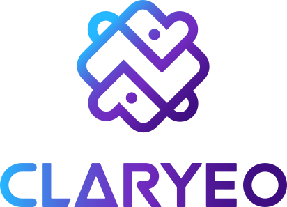

  

<h3 align="center">Control, confidence and clarity over your business's money.</h3>

  <a href="https://claryeo.com"><strong>Website</strong></a> ·
  <a href="https://www.linkedin.com/company/claryeo/">LinkedIn</a> ·
  <a href="https://x.com/claryeoofficial">X</a> ·
  <a href="https://instagram.com/claryeoofficial">Instagram</a>

---

Claryeo is finance software for Nigerian businesses. It brings invoicing, expenses, bank activity, reports and tax into one place, so business owners always know what they're owed, what they've spent and what tax is due, without needing a finance degree.

### What Claryeo does

- **Invoicing:** create and send invoices by email or WhatsApp, and track them from draft to paid.
- **Automatic reconciliation:** connected bank accounts match incoming payments to the invoices they settle.
- **Expenses and reports:** profit and loss, cash flow, invoice aging and more, built from your own books.
- **Tax made plain:** tax summaries and VAT preparation under Nigerian rules, with an AI assistant that answers questions using your business's actual numbers.

### Who it's for

SME owners, freelancers, accountants and bookkeepers, and in-house finance teams.

### Get in touch

Questions, partnerships or press: [hello@claryeo.com](mailto:hello@claryeo.com)

Claryeo is operated by JLA Technologies Ltd. Claryeo does not provide official legal, tax or financial advice.
